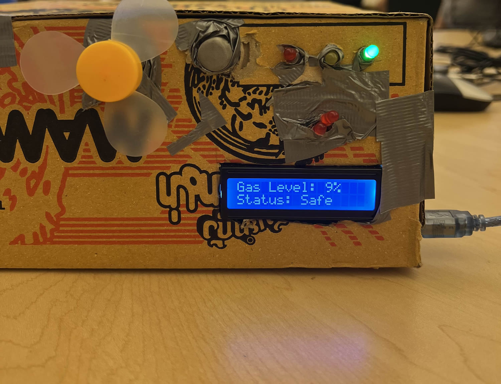
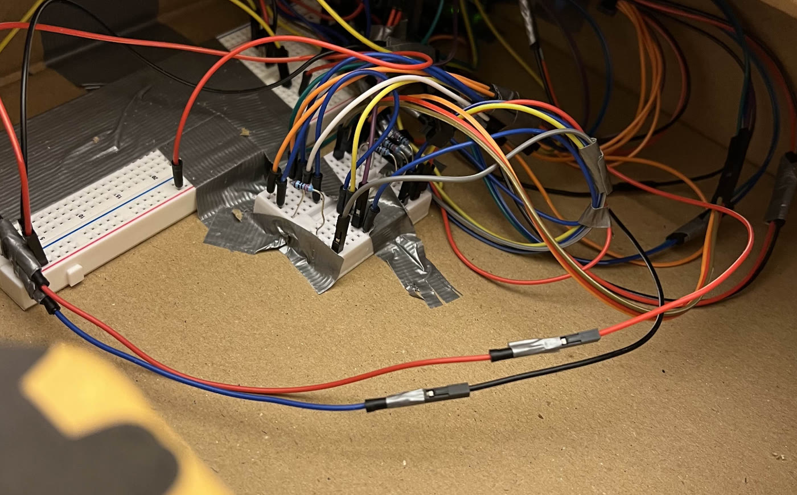

# Air Quality Monitor

De Anza College **ENGR 10** group project · due June 18, 2025

**Team:** Wenyan Chen, Trista Chen, Ricardo Barron, Luke Nguyen, Kevin Ngo  
**Instructor:** Saied Rafati

A cardboard-box indoor air-quality monitor. An Arduino UNO reads a gas sensor, shows status on an LCD1602, lights green / yellow / red LEDs, and turns on a fan when the air is harmful or dangerous.

  
  

The same project also lives on its own: [trista-chen-29/air-quality-monitor](https://github.com/trista-chen-29/air-quality-monitor). This folder is the copy inside the portfolio. The two build photos are on the portfolio project card.

## What it does

The loop reads the sensor on `A5` and maps the raw value from 0–900 onto a 0–100 gas level for the display. LED and fan follow the raw reading:

| Raw reading | Status | Light | Fan |
| --- | --- | --- | --- |
| under 170 | Safe | green | off |
| under 350 | Moderate | yellow | off |
| under 600 | Harmful | red | on |
| 600 and up | Danger | second red | on |

The class report stored the sketch as IDE screenshots. `AirQualityMonitor.ino` is those screens joined in order.

## Build notes

- Board: Arduino UNO R3, C++
- Display: LCD1602 (many tries; long runs could scramble characters — rewritten piece by piece)
- Fan on for harmful / dangerous
- DHT11 for temp/humidity overheated during test and did not ship
- Gas tests used butane from a lighter
- Parts ~$40 (under the ~$75 survey willingness-to-pay)

## In this folder

| Path | What it is |
| --- | --- |
| `AirQualityMonitor.ino` | Arduino sketch |
| `photos/` | Front of the box and the wiring inside |
| `docs/ENGR10-final-report.txt` | Class report text |
| `charts/` | Survey charts, Gantt chart, and code screenshots from the report |
